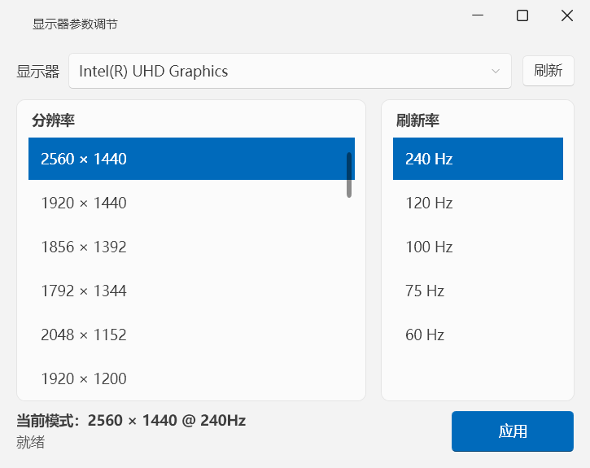

# Windows 显示器工具集

两个轻量的 Windows 显示器管理小工具：**一键切换 280Hz 刷新率** 与 **分辨率 / 刷新率调节面板**。

| 工具 | 技术栈 | 形态 |
|---|---|---|
| [refresh280](refresh280/) | C++ / Win32 API（MinGW 编译） | 单文件 exe（约 260KB），零依赖，双击即切换到 280Hz |
| [DisplayTuner](display-tuner/) | C# / .NET 10 / WPF（Fluent 2 主题） | 图形界面，自由调节任意显示器的分辨率与刷新率 |



## 共同的安全设计（防黑屏）

显示模式切换失败可能导致黑屏或无法操作，两个工具都内置了同一套保险机制：

1. **预检**：`CDS_TEST` 校验目标模式是否可用（不改变任何设置）
2. **应用 + 验证**：切换后重新枚举显示模式，确认分辨率 / 刷新率真正生效，而不是只看 API 返回值
3. **15 秒确认保险**：应用后弹出置顶确认窗口，15 秒内不确认自动恢复原设置；应用阶段不写注册表，即使程序意外退出也不会留下坏设置
4. **点击"保持"后才持久化**：写入系统显示设置，重启后仍生效
5. **失败自动回滚**：预检失败不做任何更改；应用失败回滚已切换的显示器并明确提示原因
6. **只操作物理显示器**：自动过滤虚拟显示适配器（向日葵 / ToDesk 等远程控制驱动）
7. **NTSC 刷新率容差**：请求 60Hz 时系统会以 59.94Hz 生效并回读为 59Hz，验证按 ±1Hz 判定

> 两套工具都是在 **NVIDIA RTX 4070 Laptop + 外接 2K 280Hz 显示器** 的环境下实机开发与验证的。

## refresh280 —— 一键切换 280Hz

双击 `refresh280.exe`，程序自动查找当前分辨率下可用的 280Hz 模式并切换：

- 已是 280Hz → 提示无需切换
- 显示器不支持 280Hz → 明确报错，不做任何更改
- 切换成功 → Windows 系统通知 + 确认窗口（保持 / 恢复 / 15 秒超时自动恢复）
- 支持多显示器、自动跳过虚拟显示适配器、`--noop` 诊断模式

编译（需要 MinGW-w64 g++ 8.1+ 与 windres）：

```bat
cd refresh280
build.bat
```

## DisplayTuner —— 分辨率 / 刷新率调节面板

Fluent 2 风格界面：Mica 云母背景、深浅色跟随系统、高 DPI 自适应。

- 选择显示器 → 分辨率（按像素面积降序）→ 刷新率（随分辨率联动），点击"应用"
- 应用后进入与 refresh280 相同的 15 秒确认流程
- 提供 `--noop` 诊断模式（模式清单输出到 `%TEMP%\displaytuner_debug.txt`）

运行需要 [.NET 10 桌面运行时](https://dotnet.microsoft.com/download/dotnet/10.0)（安装 .NET 10 SDK 亦可）。

编译：

```bat
cd display-tuner
build.bat
```

## 下载

见 [Releases](../../releases)：预编译好的 `refresh280.exe`（免安装）与 `DisplayTuner.exe`。

## 适用环境

- Windows 10 / 11（x64）

## License

[MIT](LICENSE)
